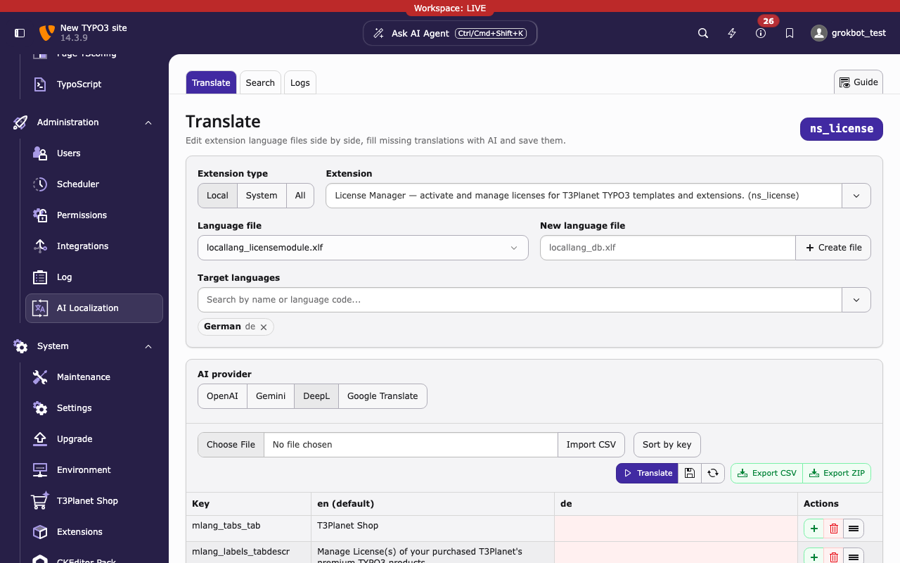

.. include:: ../Includes.txt

.. _installation:

============
Installation
============

.. _requirements:

Requirements
============

*  **TYPO3** 12.4 LTS (12.4.18 or newer), 13.4 LTS or 14.3 LTS
*  **PHP** 8.2 to 8.5
*  **EXT:ns_license** (``nitsan/ns-license``) 14.5.4 or a later 14.x version.
   Composer installs it automatically.
*  Outbound HTTPS connections to the translation providers you use (and to
   Crowdin, if you upload translations).
*  Write access for the web server to the ``Resources/Private/Language/``
   folders of the extensions you want to translate.

.. _installation-composer:

Composer mode
=============

..  code-block:: bash
    :caption: Install via Composer

    composer require nitsan/ns-t3al
    vendor/bin/typo3 extension:setup
    vendor/bin/typo3 cache:flush

``extension:setup`` creates the database table for the translation logs.

.. _installation-classic:

Classic mode
============

1. Install the extension in :guilabel:`Admin Tools > Extensions`.
2. Run :guilabel:`Admin Tools > Maintenance > Analyze Database Structure`
   and create the table ``tx_nst3al_domain_model_logs``.
3. Clear all caches.

.. _installation-license:

License
=======

The extension is free. No license key and no license activation are needed.
EXT:ns_license is only a required dependency and is installed automatically
with Composer.

.. _installation-next-steps:

Next steps
==========

1. Add the API key of at least one translation provider, see
   :ref:`configuration`.
2. Open :guilabel:`Admin Tools > AI Localization` (on TYPO3 v14:
   :guilabel:`Administration > AI Localization`).

   :guilabel:`AI Localization` in the TYPO3 v14 module menu (group
   :guilabel:`Administration`; :guilabel:`Admin Tools` on TYPO3 v12 and v13).
