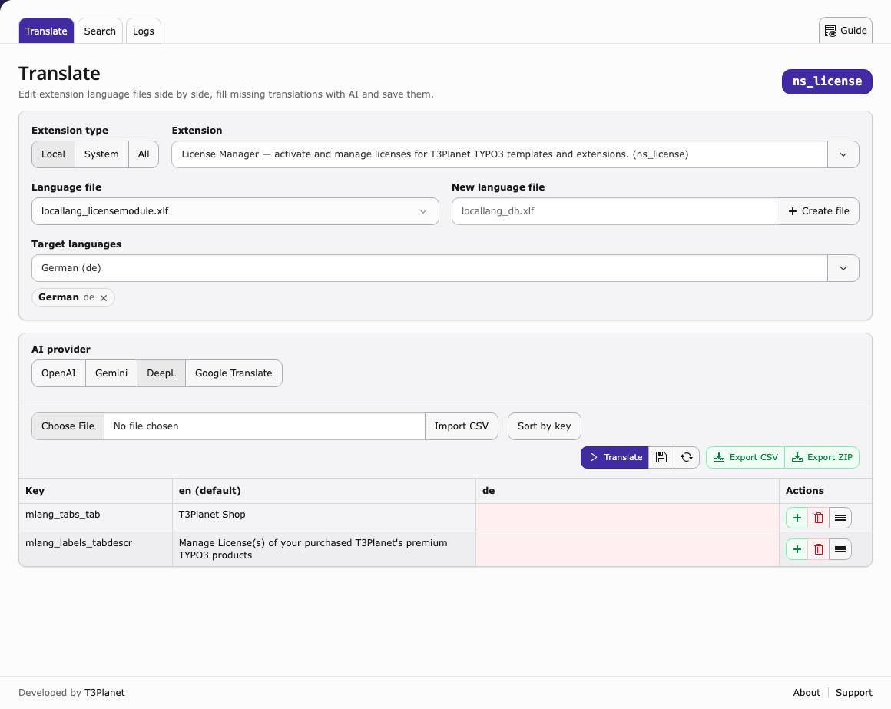
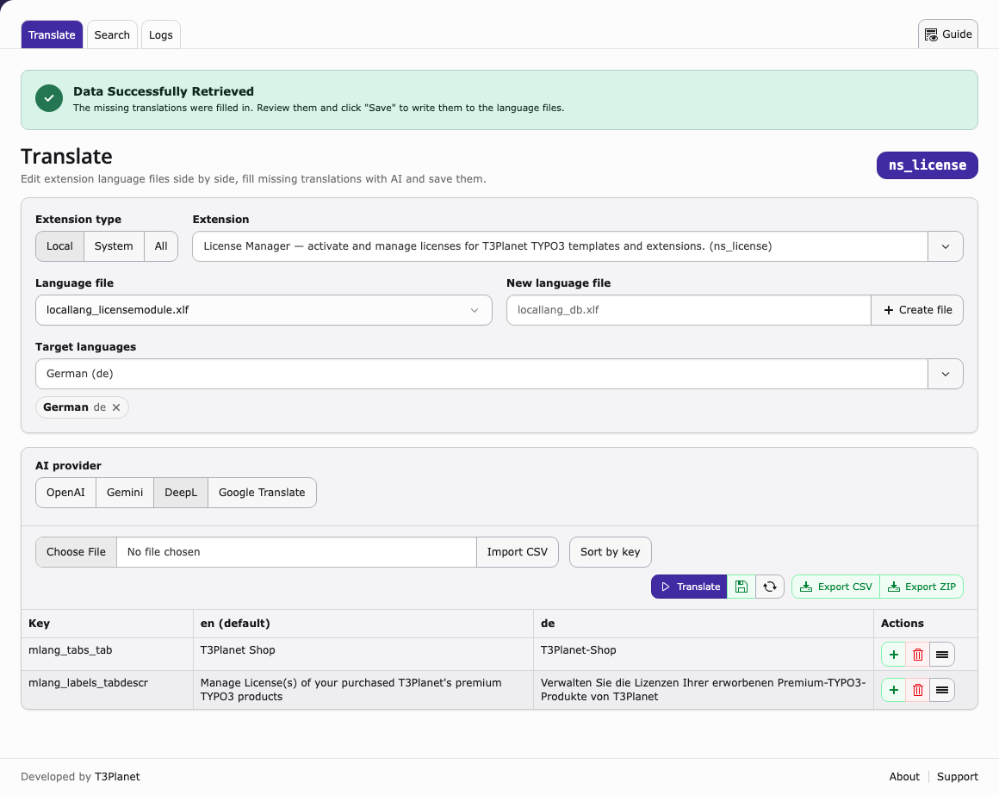
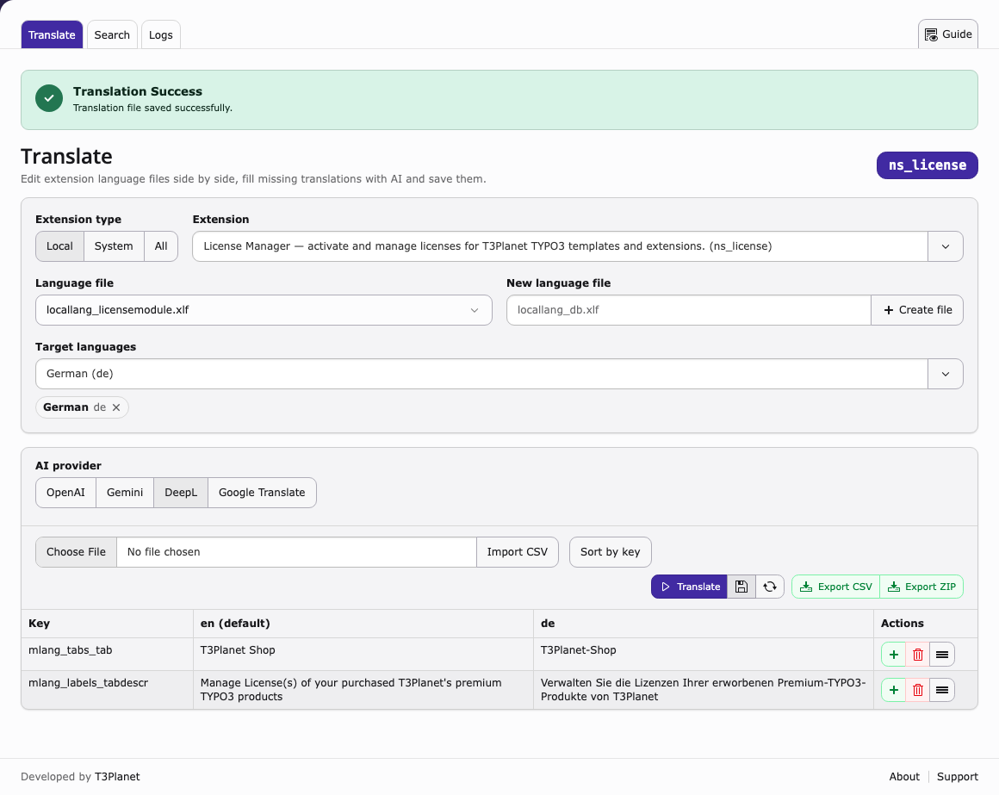
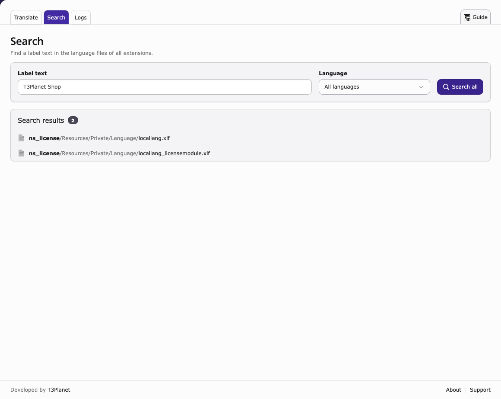
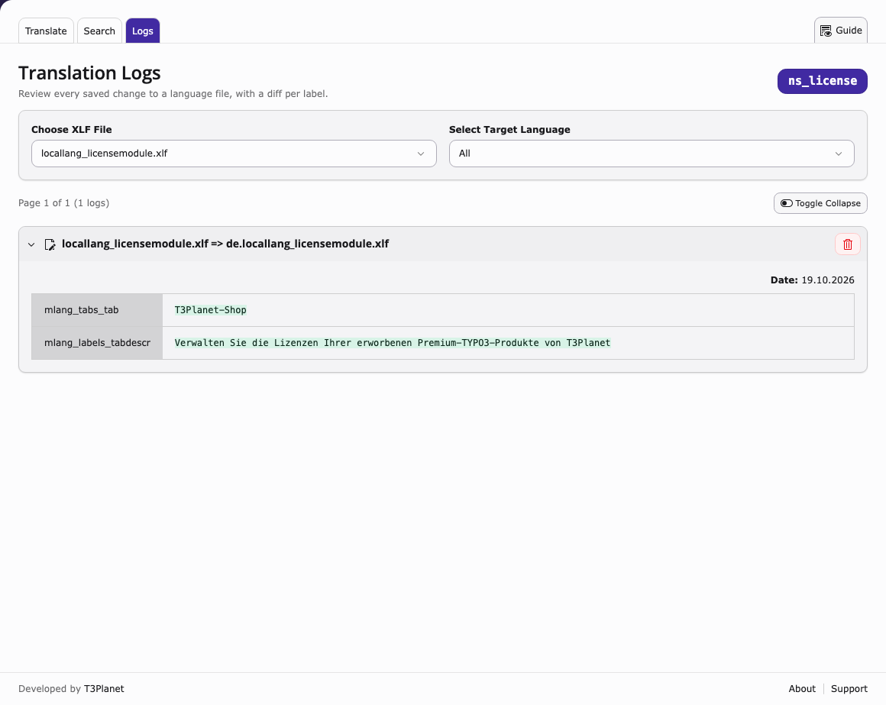

.. include:: ../Includes.txt

.. _screenshots:

===========
Screenshots
===========

Translate
=========

   Select an extension, a language file and the target languages.

   Empty translations filled by the AI provider.

   The language file was saved.

Search
======

   Search a label text in all extensions.

Logs
====

   Every saved change with a diff per label.
