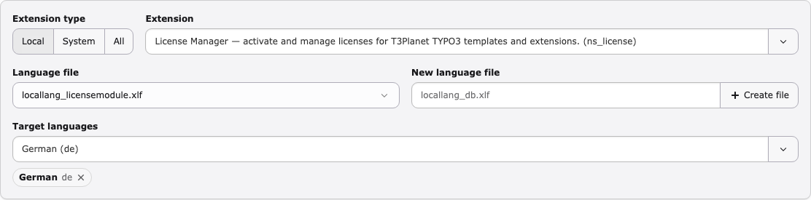
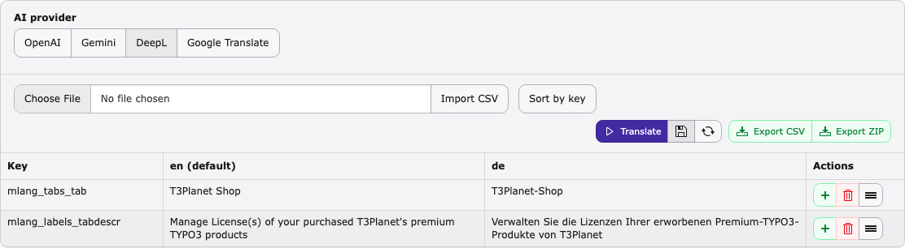

.. include:: ../Includes.txt

.. _user-guide:

==========
User guide
==========

Open :guilabel:`Admin Tools > AI Localization` (on TYPO3 v14:
:guilabel:`Administration > AI Localization`). The module has three tabs,
:guilabel:`Translate`, :guilabel:`Search` and :guilabel:`Logs`, and a
:guilabel:`Guide` button on the right.

.. contents::
   :local:
   :depth: 1

.. _user-guide-select:

Select extension, file and languages
====================================

   Choose what you want to translate.

Extension type
   :guilabel:`Local` (your own and third-party extensions, default),
   :guilabel:`System` (TYPO3 system extensions) or :guilabel:`All`.

Extension
   Type to search by title or extension key.

Language file
   The ``.xlf`` files directly in ``Resources/Private/Language/`` of the
   extension. Files in subfolders and translation-only files are not listed.

Target languages
   Search and pick one or more languages. Each language becomes a column in
   the grid. English is always the source (``default``) column.

.. _user-guide-grid:

Edit labels in the grid
=======================

The grid shows one row per label key. You can type in every cell you are
allowed to edit.

*  Empty translations and missing English sources are highlighted, and
   translations identical to the English text are marked.
*  Administrators can rename keys, add a row below (:guilabel:`+`), delete a
   row and drag rows to a new position.
*  :guilabel:`Sort by key` sorts the rows alphabetically; the order is
   written on the next save.
*  While there are unsaved changes, the :guilabel:`Save` button is
   highlighted and TYPO3 asks before you leave the module.

.. _user-guide-translate:

Translate with AI
=================

   AI provider and editor actions.

1. Under :guilabel:`AI provider`, choose :guilabel:`OpenAI`,
   :guilabel:`Gemini`, :guilabel:`DeepL` or :guilabel:`Google Translate`.
   For OpenAI and Gemini you can also pick the model.
2. Click :guilabel:`Translate`.
3. The empty translations of all selected languages are filled. Existing
   translations are not changed.
4. Review the result in the grid and correct it if needed.

If every label already has a translation, the module shows
:guilabel:`Nothing to translate` and nothing changes. If some labels could
not be translated, a warning tells you how many were filled; the rest stay
empty.

.. _user-guide-save:

Save
====

Click :guilabel:`Save` (disk icon) to write the grid to the language files.

*  Translations are written to ``<language>.<file>.xlf`` next to the English
   file, for example ``de.locallang.xlf``.
*  Only files that really changed are written. If nothing changed, you see
   :guilabel:`No changes`.
*  For TYPO3 system extensions the English file is read-only and the
   translations are saved in the TYPO3 labels folder
   (``var/labels/<language>/<extension>/`` in Composer mode).

.. figure:: ../Images/save-success.png
   :alt: Translation Success message after saving
   :class: with-border with-shadow
   :zoom: lightbox

   The file was saved.

:guilabel:`Reload` discards unsaved changes and reloads the files from disk.

.. _user-guide-create-file:

Create a language file
======================

Administrators can enter a file name in :guilabel:`New language file`, for
example ``locallang_db.xlf``, and click :guilabel:`Create file`. An empty
XLIFF file is created and selected. Creating files is not possible for TYPO3
system extensions.

.. _user-guide-csv:

CSV export and import
=====================

Export CSV
   Downloads the current grid as a CSV file (key, English and one column per
   language), for example to send it to a translator.

Import CSV
   Administrators choose a CSV file and click :guilabel:`Import CSV`. The CSV
   is merged into the grid: existing labels are updated, new keys are added,
   and keys or languages that are not in the CSV stay unchanged. Click
   :guilabel:`Save` to write the result. A header ``en``, ``default`` or
   ``… (default)`` marks the English column.

.. _user-guide-zip:

Export ZIP
==========

:guilabel:`Export ZIP` downloads all language files of the extension as a
ZIP archive. It is available when :confval:`enableExport <confval-enableexport>`
is enabled and the extension is not a TYPO3 system extension.

.. _user-guide-search:

Search
======

.. figure:: ../Images/search.png
   :alt: Search tab with results in the ns_license language files
   :class: with-border with-shadow
   :zoom: lightbox

   Search a label text in all extensions.

Enter a text, optionally choose a language (:guilabel:`All languages`,
:guilabel:`English (source)` or one language) and click
:guilabel:`Search all`. The search is case-insensitive. Click a result to
open the file in the Translate tab. At most 100 files are listed; refine the
text or pick a language if there are more.

.. _user-guide-logs:

Logs
====

.. figure:: ../Images/logs.png
   :alt: Translation Logs with a saved German translation and its diff
   :class: with-border with-shadow
   :zoom: lightbox

   Every saved change with a diff per label.

On the :guilabel:`Logs` tab choose an extension, then filter by language file
and target language. Each entry shows the date and the removed and added text
per label. :guilabel:`Toggle Collapse` expands or collapses all entries, and
the delete icon removes an entry. Logs are only written when
:confval:`enableLogs <confval-enablelogs>` is enabled; old entries are removed
after :confval:`logRetentionDays <confval-logretentiondays>`.

.. _user-guide-guide:

Interactive guide
=================

Click :guilabel:`Guide` at the top right to open an interactive walkthrough of
the module in a modal window.
