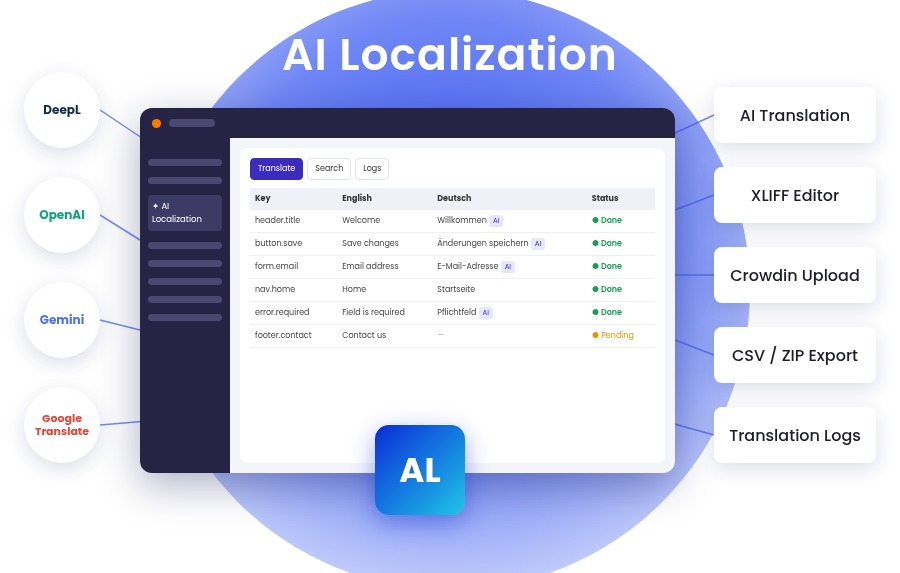

[](https://extensions.typo3.org/extension/ns_t3al)
[](https://github.com/nitsan-technologies/ns_t3al)
[](https://get.typo3.org/version/14)
[](https://get.typo3.org/version/13)
[](https://get.typo3.org/version/12)
[](https://www.php.net/)
[](https://github.com/nitsan-technologies/ns_t3al/actions/workflows/core12.yml)
[](https://github.com/nitsan-technologies/ns_t3al/actions/workflows/core13.yml)
[](https://github.com/nitsan-technologies/ns_t3al/actions/workflows/core14.yml)

# AI-Powered XLIFF Translation for TYPO3 Extension `ns_t3al`

[](https://t3planet.de/t3al-typo3-erweiterung)

TYPO3 backend module (**Admin Tools → AI Localization**) for translating extension XLIFF files
(`Resources/Private/Language/*.xlf`) in a spreadsheet-style grid:

- edit source and target labels of several languages side by side;
- fill empty targets with AI: OpenAI, Gemini, DeepL or Google Translate;
- save locally, or upload translations of TYPO3 system extensions to Crowdin;
- import / export CSV, export all language files as ZIP;
- search labels across extensions;
- translation logs with a diff of every saved change.

|                       | URL                                                                 |
|-----------------------|---------------------------------------------------------------------|
| **Repository:**       | https://github.com/nitsan-technologies/ns_t3al                      |
| **Issues:**           | https://github.com/nitsan-technologies/ns_t3al/issues               |
| **Product Page:**     | https://t3planet.de/t3al-typo3-erweiterung                          |
| **Support:**          | https://t3planet.de/support                                         |
| **License:**          | [LICENSE](LICENSE) (GPL-2.0-or-later)                               |

## Requirements

- TYPO3 12.4 LTS, 13.4 LTS or 14.3 LTS (classic or Composer mode)
- PHP version supported by the TYPO3 version
- `nitsan/ns-license` 14.5.4 or later 14.x (installed automatically; no license key needed — the extension is free)

## Installation

Composer mode:

```bash
composer require nitsan/ns-t3al
vendor/bin/typo3 extension:setup
```

Classic mode: install the extension in **Admin Tools → Extensions**, then run **Analyze Database Structure**.

## Configuration

**Admin Tools → Settings → Extension Configuration → ns_t3al**

| Setting | Purpose |
|---|---|
| `openaiApiKey`, `openaiApiModel` | OpenAI |
| `geminiApiKey`, `geminiApiModel` | Gemini |
| `deeplApiKey`, `deeplApiUrl` | DeepL (Free: `https://api-free.deepl.com/v2/translate`) |
| `googleApiKey`, `googleApiUrl` | Google Translate v2 |
| `accessToken`, `crowdinApiUrl`, `crowdinSystemExtensionPath` | Crowdin API (upload of system-extension translations) |
| `enableLogs`, `logRetentionDays` | Translation logs; logs older than the retention period are deleted (0 = keep all) |
| `enableExport` | "Export ZIP" action |

Non-admin editors need access to the module and the extensions they may edit:
**Backend user group → Access Rights → Custom module options → AI Localization: editable extensions**.

## Development

```bash
composer install
composer test   # unit tests (Build/phpunit/UnitTests.xml)
composer ci     # unit tests + PHPStan + coding standards
```

GitHub Actions (`.github/workflows/core12.yml`, `core13.yml`, `core14.yml`) run the same checks per TYPO3 major
through the Docker test runner, which you can also use locally:

```bash
Build/Scripts/runTests.sh -t 13 -p 8.3 -s composerInstallHighest
Build/Scripts/runTests.sh -t 13 -p 8.3 -s unit
Build/Scripts/runTests.sh -h    # all suites and options
```

Architecture notes for contributors: `AGENTS.md` and `context/` (git repository only; like `Build/` and
`Tests/` they are `export-ignore`d in `.gitattributes` and not part of release archives).

## License

GPL-2.0-or-later

