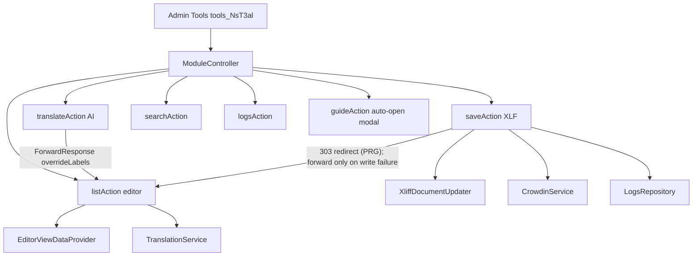

# ns_t3al — architecture

## Request path (primary)

## Extbase actions (`Configuration/Backend/Modules.php`)

| Action | Role |
|---|---|
| `list` | Main Translate editor (default) |
| `translate` | AI fill → forward to `list` with `overrideLabels` |
| `save` | Persist XLF (+ optional Crowdin, system extensions only); redirects to `list` (Post/Redirect/Get) so a browser reload never saves again |
| `search` | Cross-extension label search (`LabelSearchService`; optional language filter, max 100 result files) |
| `createFile` | Admin: new empty `.xlf`; redirects to `list` on success |
| `importCsv` / `exportCsv` | CSV in/out (the upload is read via `php://temp`, no temporary file is left behind; formula cells escaped via `CsvCellEscaper`; an import is merged with the file via `mergeImportedLabels()`, so a partial CSV never drops keys) |
| `logs` | Translation log browser (20 per page, `currentPage`) |
| `export` | "Export ZIP" editor action: streams the extension's whole `Resources/Private/Language` tree (incl. sub folders, relative entry names) as `<ext>_Localization_<YmdHi>.zip` via `LanguageArchiveBuilder` (unique temp file, removed after sending). Only for extensions from `getAvailableExtensions()`, never framework packages, only with `enableExport = 1` — otherwise, or when building fails, an error flash message and redirect to `list` |
| `guide` | Thin page; auto-opens Guide modal |

There are no stub actions: unknown action paths (e.g. the removed `aiLocalization` / `manual` / `validate`) fall back to the TYPO3 default backend route.

Docheader: TYPO3 Module DocHeader is **disabled**. Custom tabs come from `buildModuleTabs()` + `Partials/Module/DocHeaderTabs.html` (Translate / Search / Logs only).

## Access control

Admins edit everything; non-admins only extensions granted via Custom module options (`ns_t3al_extensions`). `ExtensionAccessService::canEdit()` is the single check; no AJAX routes exist. Details and editor lock: `features/access-control.md`.

## Events and caches

| Registration | Where | Purpose |
|---|---|---|
| Cache `ns_t3al_editor_lock` (`SimpleFileBackend`, 600 s) | `ext_localconf.php` | Concurrent-edit lock |
| Cache `ns_t3al_deepl_languages` (`FileBackend`, 86400 s) | `ext_localconf.php` | DeepL target language list |
| `BE.customPermOptions.ns_t3al_extensions` | `ext_localconf.php` | Per-extension permission for non-admins |
| CSP `frame-src https://app.supademo.com` (backend) | `Configuration/ContentSecurityPolicies.php` | Guide modal iframe |

## Persistence

| Store | What |
|---|---|
| **XLF files** | Source of truth under `EXT:…/Resources/Private/Language/`. Framework (`typo3-cms-framework`) translations go to `Environment::getLabelsPath()`; their English source files are Core files and are **never written** (key / source edits are ignored with a warning) |
| **BE module data** | `extkey`, `file`, `langKeys`, `extType`, `apiModel`, `time`, `sessid` as a plain array via `BackendUserAuthentication::getModuleData()` / `pushModuleData()` for `tools_NsT3al` (never `serialize()` / `unserialize()`; old serialized strings are ignored) |
| **DB** | `tx_nst3al_domain_model_logs` — extension, files, target language, request mode, diff. `content` is JSON plain text `{unitId: {source: {del, ins}, target: {del, ins}}}` built by `XliffUtility::computeDiff()`; `LogContentNormalizer` turns it (and legacy `<del>`/`<ins>` markup rows) into escaped segments for `Partials/Logs.html`. Rows older than `logRetentionDays` (default 365, `0` = keep) are deleted after each new log row (`LogsRepository::deleteExpired()`). Rows with an empty `content` are never listed (`findRecords()` / `findTargetLanguage()`). TCA labels: `locallang_db.xlf`; no workspace / language fields |
| **Ext conf** | API keys, Crowdin token, feature flags |

After a save with at least one written file, and after Create file, `ModuleController::flushLabelCache()` flushes the core `l10n` cache: its entries ignore file modification times, so saved labels would otherwise stay stale in backend / frontend until a manual flush. Rendered frontend pages in the page cache are not flushed.

Save updates existing XLF files **in place** (`EditorViewDataProvider::buildLanguageFile()` → `XliffDocumentUpdater` + `XliffFormatRestorer`): only changed `<source>` / `<target>` nodes are touched, header / notes / `date` / `approved` / `state` / `xml:space` / comments / formatting survive, and a file whose content did not change is not written at all (English `default` is only rewritten when keys or English texts changed). `XliffUtility::generateXml()` is used only for files that do not exist yet.

AI translate keeps results in the form until **Save**. AI batches are structured (keyed JSON / native arrays) and count-checked; a batch whose response does not contain exactly the requested keys is rejected, never shifted. CSV import loads into the grid as `overrideLabels` without writing disk until Save.

## Important file map

| Area | Paths |
|---|---|
| Controllers | `Classes/Controller/ModuleController.php` (the only controller) |
| Providers | `Classes/Backend/View/EditorViewDataProvider.php`, `LogsViewDataProvider.php` |
| Services | `LanguageArchiveBuilder.php` (Export ZIP), `TranslationService.php`, `AiProviderResolver.php` (single provider → API key setting map: configured check + selected / fallback provider for every controller), `OpenAiService.php`, `GeminiService.php` (model allowlist like OpenAI), `DeepLService.php` (+ `DeepLLanguageMapper.php` TYPO3 key → DeepL target code, `DeepLLanguageProvider.php` live target list, cached daily), `GoogleService.php` (+ `ProviderErrorTrait.php`: log + status array for every provider error), `CrowdinService.php` (never throws; errors logged and returned; path segments `rawurlencode()`d, queries built with `http_build_query()`), `ActiveLanguagesProvider.php` (active language packs on v12/v13/v14 without a hard EXT:install dependency), `LabelSearchService.php` (Search tab: existing files only, framework packages only in active language packs, values compared after XLIFF parsing) |
| Utility / domain | `XliffUtility.php` (parse / new-file XML / `getFileList()`: top-level base files only / log diff), `LogContentNormalizer.php` (log diff → escaped segments), `XliffDocumentUpdater.php` (in-place save; grid order only after rows were moved), `XliffFormatRestorer.php` (keeps untouched lines byte-identical), `LabelBatchUtility.php` (structured AI batches — see `features/ai-and-crowdin.md`), `CsvCellEscaper.php` (CSV formula-injection escape / lossless unescape), `Domain/Model/Logs.php` (read-only: Extbase maps log rows for `Partials/Logs.html`; rows are written by `LogsRepository::insertRecord()`), `Domain/Repository/LogsRepository.php` |
| Config | `Configuration/Backend/Modules.php`, `Services.yaml` (the only DI config — no `Services.php`), `JavaScriptModules.php` (one folder import `@nitsan/ns-t3al/`, no tags), `ContentSecurityPolicies.php` (Supademo frame), `Icons.php` (`t3al-icon` only), `TCA/tx_nst3al_domain_model_logs.php`, `ext_localconf.php` (caches, permission options), `ext_conf_template.txt`, `ext_tables.sql` |
| Templates | `Layouts/Module.html` (kept as `.html`, not `.fluid.html`: Fluid 2 on v12/v13 only resolves `.html`), `Templates/Module/{List,Search,Logs,Guide}.html`, `Partials/Logs.html` |
| Partials (module) | `Partials/Module/{Filter,Toolbar,EditorActions,GridActions,LabelGrid,DocHeaderTabs,Icons}.html` |
| JS | `module-functionality.js` (combobox, filters, AI submit, grid rows add / delete / move), `module-ui.js` (dirty save, Guide modal via `@typo3/backend/modal.js`), `unsaved-changes.js` (leave guard: browser prompt + backend module switch modal while Save is red) |
| CSS | `Resources/Public/Css/module.css` |
| Unit tests | `Tests/Unit/` (`Utility/` path guards, file index / file list, XLIFF round trip, in-place save, AI batch JSON, log diff + normalizer, CSV cell escaping; `Backend/View/` key changes, duplicate / invalid key guard, partial CSV merge, target languages without `en`, grid → language file, module data; `Service/` translation batching, provider resolution, Gemini model allowlist, Export ZIP archive, DeepL request / target codes / language list, Crowdin URL building), `Build/phpunit/UnitTests.xml`; run `composer install && composer test` (tooling in git-ignored `.Build/`) |

## Unit tests

`typo3/testing-framework` unit tests, no database or TYPO3 instance. Path tests use a real temp directory (symlink / `realpath()` checks). `EditorViewDataProvider` tests use `Tests/Unit/Support/EditorViewDataProviderFactoryTrait.php` (real XLIFF collaborators, `readRaw()` from memory); `TranslationService` tests override the protected `translate()` so failure messages need no localization bootstrap. Add a test with every change to a path guard, the XLIFF read/write path or batching.

## No second UI

The former Localization modal UI was removed completely: AJAX controllers (`T3AiLocalizationController`, `T3AiTranslationController`, `AbstractAIController`), `Configuration/Backend/AjaxRoutes.php`, their view data providers, the code editor ViewHelper / utility (t3editor), `Partials/Localization*`, `ALModalManager.js`, `actions.js` and `Style.css`. All features live in `ModuleController`; all XLF writes go through `saveAction`. Do not reintroduce AJAX side doors — add module actions instead.

### Extension Manager is not overridden

ns_t3al does **not** override the core Extension Manager list (no `templates.typo3/cms-extensionmanager` page TSconfig, no `module.tx_extensionmanager` TypoScript, no forked `List/Index.html`). Do not reintroduce a fork: it breaks on core updates (v14 removed `ToggleExtensionInstallationStateViewHelper`). Entry points are the Admin Tools module and its deep links, e.g. `/typo3/module/tools/ns-t3al?token=…&extensionKey=<key>[&file=locallang.xlf]` (Translate) or the Logs tab (`logs?extensionKey=<key>`).

## Architecture in one line

One Admin Tools editor (`list`) owns the whole UX (no AJAX routes, no second UI); Crowdin + multi-provider AI attach to the same grid Save/Translate path.
